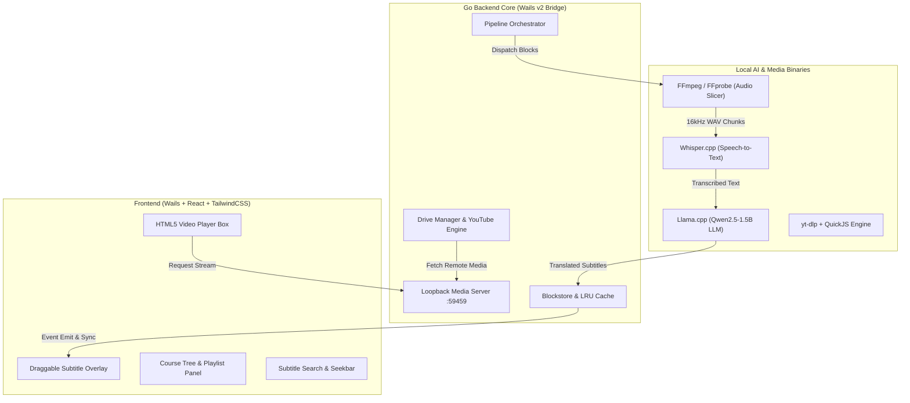

# 🎬 SubTrans Video Player
### Trình phát & Dịch phụ đề Video Song ngữ Thời gian thực (Realtime Offline Video Translator)

<p align="center">
  
  
  
  
  
  
  
</p>

---

## 📖 Giới thiệu (Overview)

**SubTrans** là ứng dụng Desktop đa nền tảng (chuyên biệt cho Windows) giúp người dùng học tập và xem các video bài giảng tiếng nước ngoài một cách mượt mà nhất. 

Ứng dụng tự động lắng nghe giọng nói trong video, tạo phụ đề gốc và dịch song ngữ sang Tiếng Việt **hoàn toàn Offline cục bộ trên máy tính** thông qua các mô hình AI mã nguồn mở tiên tiến (`whisper.cpp` + `llama.cpp`), đảm bảo **100% tính riêng tư, bảo mật dữ liệu và không tốn chi phí API đám mây**.

---

## ✨ Tính năng nổi bật (Key Features)

### 🤖 1. Dịch thuật thời gian thực hoàn toàn Offline (100% Local AI)
- **Speech-to-Text (STT)**: Tích hợp `whisper.cpp` nhận diện giọng nói chính xác theo từng phân đoạn âm thanh nhỏ.
- **Machine Translation (MT)**: Tích hợp `llama.cpp` kết hợp model `Qwen2.5-1.5B-Instruct` được tối ưu prompt chuyên sâu cho dịch thuật video kỹ thuật, công nghệ và bài giảng học thuật.
- **Hỗ trợ tăng tốc phần cứng (Hardware Acceleration)**: Tự động tận dụng GPU (NVIDIA CUDA / Vulkan) nếu có, hoặc chạy nhẹ nhàng trên CPU đa luồng.

### ⚡ 2. Pipeline xử lý phân tầng thông minh (Tiered Real-time Pipeline)
- **Xử lý đón đầu (Lookahead Buffer)**: Không cần chờ đợi phân tích hết video mới được xem. Video vừa mở là phát ngay.
- **Tier-1 (High Priority)**: Ưu tiên tài nguyên máy dịch ngay lập tức phân đoạn tại vị trí con trỏ phát video (Playhead).
- **Tier-2 (Background Processing)**: Tự động chạy nền các block tiếp theo để khi người dùng xem tới nơi, phụ đề đã sẵn sàng.
- **Bộ nhớ đệm thông minh (LRU Block Cache & Store)**: Tự động lưu trữ tiến độ và phụ đề đã dịch, tua đi tua lại tức thì không cần dịch lại.

### 📺 3. Trình phát Video hiện đại & Kéo thả Phụ đề tự do (Draggable Overlay)
- Giao diện Dark mode tối giản, sang trọng, tập trung tối đa vào nội dung học tập.
- **Kéo thả vị trí phụ đề**: Người dùng có thể nhấp giữ và **kéo thanh phụ đề đến bất kỳ vị trí nào** trên màn hình (trên, dưới, các góc) tùy theo bố cục của từng video.
- **Tự động lưu & thích ứng**: Tọa độ được lưu tự động vào `localStorage` theo tỉ lệ màn hình; tương thích hoàn hảo khi bật/tắt Toàn màn hình (Fullscreen).
- **Phục hồi mặc định**: Nhấp đúp chuột (Double click) để đưa phụ đề về vị trí tiêu chuẩn.
- Các chế độ hiển thị: Song ngữ (`Bilingual`), Chỉ Tiếng Việt (`VI`), Chỉ Tiếng Anh (`EN`), hoặc Tắt (`Off`).

### 🌐 4. Tải & Phát tự động từ YouTube (YouTube Integration)
- Dán link YouTube để ứng dụng tự động tải luồng video chất lượng cao và chuyển đổi sang trình phát.
- **Tự động tích hợp QuickJS-NG**: Tích hợp JavaScript Runtime gọn nhẹ (`quickjs.exe` ~2MB) giúp `yt-dlp` vượt qua các thử thách bot check token của YouTube.
- **Graceful Fallback**: Nếu YouTube áp đặt giới hạn tải phụ đề (HTTP Error 429), quy trình tải video vẫn hoàn tất 100%, sau đó hệ thống tự động điều hướng sang Whisper STT để nghe và tạo phụ đề tự động.

### ☁️ 5. Đồng bộ & Phát trực tiếp Google Drive (Direct Drive Streaming)
- Tích hợp OAuth 2.0 đăng nhập Google Drive trực tiếp.
- **Quét đệ quy cây thư mục khóa học** từ Google Drive không giới hạn cấp thư mục.
- **Loopback Streaming Proxy**: Phát video mượt mà trực tiếp từ đám mây qua proxy nội bộ mà **không cần tải trước toàn bộ file về ổ đĩa cứng**.
- Tự động phát hiện và nạp file phụ đề `.srt`/`.vtt` đi kèm sẵn trên Drive.

### 📚 6. Quản lý thư mục khóa học & Xuất phụ đề (Course Management & Export)
- Kéo thả thư mục khóa học từ máy tính vào để tạo cây bài học trực quan.
- Tự động chuyển tiếp bài học kế tiếp (Auto-play Next).
- Tìm kiếm nội dung phụ đề bằng văn bản, bấm vào dòng phụ đề để tua video ngay đến đoạn đó.
- Xuất file phụ đề chuẩn `.srt` bất cứ lúc nào (hỗ trợ xuất Tiếng Việt, Tiếng Anh, hoặc Song ngữ).

---

## 🏗️ Kiến trúc hệ thống (System Architecture)



---

## 🛠️ Công nghệ sử dụng (Tech Stack)

| Thành phần | Công nghệ / Thư viện |
| :--- | :--- |
| **Desktop Framework** | [Wails v2](https://wails.io/) (Go + Webview2) |
| **Backend Language** | Go 1.26+ |
| **Frontend Framework** | React 18, TypeScript, Vite |
| **UI & Styling** | Tailwind CSS, Lucide React, clsx |
| **Speech-to-Text** | [whisper.cpp](https://github.com/ggerganov/whisper.cpp) (`ggml-base.bin`) |
| **LLM Translation** | [llama.cpp](https://github.com/ggerganov/llama.cpp) (`Qwen2.5-1.5B-Instruct-Q4_K_M.gguf`) |
| **Media Engine** | FFmpeg, FFprobe |
| **Online Extractors** | yt-dlp, QuickJS-NG, Google Drive API v3 |

---

## 📂 Cấu trúc thư mục (Project Structure)

```text
video_translator/
├── app.go                      # Logic điều phối chính giữa Go Backend và Wails
├── pipeline.go                 # Pipeline phân đoạn video, điều phối STT & Dịch thuật
├── pipeline_math.go            # Giải thuật toán học tính toán khối (block) và thời gian
├── media.go                    # Local loopback HTTP streaming server với bảo mật Token
├── drive_manager.go            # Quản lý xác thực OAuth2 & duyệt tập tin Google Drive
├── youtube.go                  # Bộ tải video YouTube, tích hợp QuickJS và cơ chế Fallback
├── tools.go                    # Quản lý đường dẫn, phát hiện GPU và khởi chạy nhị phân cục bộ
├── model_downloader.go         # Tự động tải mô hình AI khi khởi chạy lần đầu
├── sub_extractor.go            # Trích xuất và phân tích cú pháp phụ đề .srt / .vtt
├── lru_cache.go                # Bộ nhớ đệm LRU cho các khối phụ đề
├── blockstore.go               # Lưu trữ phụ đề bền vững trên đĩa theo bài học
├── frontend/                   # Ứng dụng giao diện người dùng React + Vite + Tailwind
│   ├── src/
│   │   ├── App.tsx             # Giao diện chính, Player và điều khiển kéo thả phụ đề
│   │   ├── components/         # Các components UI (CourseTree, SubtitleList, v.v.)
│   │   └── lib/                # Thuật toán tra cứu nhị phân phụ đề, utility
│   └── package.json
├── build/                      # Cấu hình đóng gói ứng dụng (Wails build configs)
├── tools/                      # Chứa các file thực thi (ffmpeg, whisper, llama, ytdlp...)
├── wails.json                  # Tệp cấu hình ứng dụng Wails
└── go.mod                      # Khai báo phụ thuộc Go
```

---

## 🚀 Hướng dẫn cài đặt & Chạy dự án (Getting Started)

### 1. Yêu cầu hệ thống (Prerequisites)
- **Hệ điều hành**: Windows 10 / 11 (64-bit).
- **Go**: Phiên bản `1.22+` (hoặc mới nhất).
- **Node.js**: Phiên bản `18+` và `pnpm` (hoặc `npm`).
- **Wails CLI v2**:
  ```bash
  go install github.com/wailsapp/wails/v2/cmd/wails@latest
  ```

### 2. Chuẩn bị mã nguồn
```bash
git clone https://github.com/<your-username>/video_translator.git
cd video_translator
```

### 3. Cài đặt dependencies cho Frontend
```bash
cd frontend
npm install
cd ..
```

### 4. Chuẩn bị các công cụ & Models
Đặt các công cụ thực thi vào thư mục `build/bin/tools/` (hoặc ứng dụng sẽ tự động tải các công cụ còn thiếu khi khởi động):
- `ffmpeg/`: Chứa `ffmpeg.exe` và `ffprobe.exe`.
- `whisper/`: Chứa `whisper-cli.exe`.
- `llama/`: Chứa `llama-server.exe` (hoặc thư mục `llama_cuda/` nếu có GPU NVIDIA).
- `ytdlp/`: Chứa `yt-dlp.exe` và `quickjs.exe`.

Mô hình AI lưu tại `%LOCALAPPDATA%\SubTrans\models\`:
- Model STT: `ggml-base.bin` (~140MB)
- Model dịch: `qwen2.5-1.5b-instruct-q4_k_m.gguf` (~980MB)

### 5. Chạy ở chế độ phát triển (Live Development)
```bash
wails dev
```
Trình duyệt / Cửa sổ desktop sẽ tự động khởi động với tính năng Hot-Reload cho cả Backend Go và Frontend React.

### 6. Đóng gói bản cài đặt (Build Release)
```bash
wails build -clean
```
File thực thi `.exe` duy nhất hoàn chỉnh sẽ được xuất ra tại thư mục `build/bin/`.

---

## ⌨️ Phím tắt tiện ích (Keyboard Shortcuts)

| Phím tắt | Chức năng |
| :---: | :--- |
| `Space` / `K` | Phát / Tạm dừng video (Play / Pause) |
| `←` / `→` | Tua lùi / Tua tới 5 giây |
| `J` / `L` | Tua lùi / Tua tới 10 giây |
| `↑` / `↓` | Tăng / Giảm 5% âm lượng |
| `M` | Bật / Tắt tiếng (Mute) |
| `F` | Bật / Thoát chế độ toàn màn hình (Fullscreen) |
| `C` | Chuyển đổi nhanh chế độ phụ đề (`Bilingual` $\rightarrow$ `VI` $\rightarrow$ `EN` $\rightarrow$ `Tắt`) |
| `B` | Ẩn / Hiện thanh cây thư mục bài học |
| `S` | Ẩn / Hiện bảng danh sách phụ đề |
| `Ctrl + O` | Mở hộp thoại chọn file video lẻ từ máy |
| `Nhấp đúp chuột vào Sub` | Đặt lại vị trí thanh phụ đề về mặc định (dưới cùng) |

---

## 🛡️ Giấy phép (License)

Dự án được phát hành theo giấy phép [MIT License](LICENSE). Hoàn toàn tự do sử dụng cho mục đích cá nhân và học tập.
